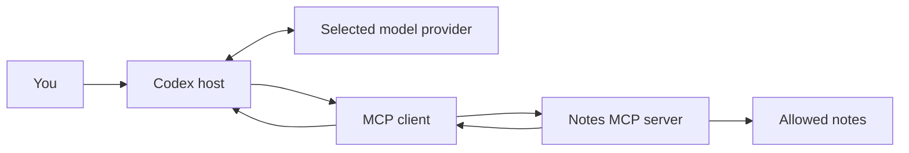

# 01 — What Connects to What?

**Version:** 0.0.1 · **Previous version:** new artifact · **Revised:** 2026-10-15 · **Status:** Sourced explanation and engineering examples

An MCP server is a program that exposes particular tools or information through a shared protocol. It might run as a process on your laptop or as a remote service. The AI application connects to it and decides how to use what it exposes. [MCP architecture](https://modelcontextprotocol.io/docs/2026-07-28/learn/architecture)

## The participants

| Participant | Job | Example in a note-search workflow |
|---|---|---|
| Model | Interprets the request and proposes tool calls | An OpenAI model or an Ollama-served model |
| Host | Runs the conversation, manages tools and execution | Codex CLI, Goose, or a custom application |
| MCP client | Implements the host's connection to a server | The MCP connection inside Codex |
| MCP server | Offers operations with defined inputs and outputs | `search_notes` and `read_note` |
| Backend | Owns the actual data or computation | Markdown files, SQLite, a repository API, or Ollama |

These roles come from the [MCP architecture](https://modelcontextprotocol.io/docs/2026-07-28/learn/architecture). The note tool names are proposed examples.

The result normally returns to the host and can become model context. A local server does not, by itself, keep its output away from a cloud-hosted model. Decide where data may go from the complete path.

## Three Ollama arrangements

| Arrangement | Main decision maker | Role of Ollama | What changes |
|---|---|---|---|
| Codex with Ollama as provider | The selected Ollama model, inside Codex's host loop | Supplies inference | Provider/model selection |
| Codex with an Ollama MCP tool | Codex's selected main model | Performs a bounded delegated operation | Adds an MCP server |
| An Ollama agent with MCP clients | The selected Ollama model, inside another host | Chooses tools and consumes results | Builds or adopts an agent host |

The first arrangement is documented by [Ollama's Codex integration](https://docs.ollama.com/integrations/codex). The second appears in [Ollama wrapper projects](04-projects-and-workflows.md#ollama-as-a-service-behind-mcp). The third appears in the [GitLab learning project](04-projects-and-workflows.md#gitlab-learning-project-follow-the-entire-tool-loop) and local agent clients.

Registering `http://localhost:11434` as an MCP URL does not convert Ollama's model API into an MCP server. The endpoint must implement MCP. An [OpenAI-compatible inference API](https://docs.ollama.com/api/openai-compatibility) and MCP serve different purposes.

## Tools, resources, and prompts

MCP servers can expose executable **tools**, readable **resources**, and reusable **prompts**. A notes server could offer a search tool, a document resource, and a literature-summary prompt. Support for one feature does not establish that a particular host uses all the others. Start with tools when portability is the priority. [MCP specification](https://modelcontextprotocol.io/specification/2026-07-28)

A skill is a set of workflow instructions. A plugin can package capabilities and instructions. An MCP server supplies an executable interface. For instance, a skill can tell Codex when to search notes, while the server implements the search. These are complementary responsibilities. See [OpenAI's plugin packaging guide](https://developers.openai.com/plugins/build/plugins).

## Two connection methods

- **stdio:** the host launches a process and exchanges protocol messages through its input/output streams. A command and its arguments identify the server.
- **Streamable HTTP:** the host connects to an already reachable MCP endpoint. A URL identifies the server. This can still be a local service.

These are the standard transport choices. Legacy HTTP+SSE appears in older projects; prefer Streamable HTTP for new HTTP integrations. [MCP transport overview](https://modelcontextprotocol.io/specification/2026-07-28/basic/transports), [Python SDK transport guide](https://py.sdk.modelcontextprotocol.io/run/)

## When MCP earns its place

MCP is useful when several hosts should reuse a stable capability, access needs a narrow boundary, or a backend has domain rules that should live behind an interface. It adds packaging, process lifecycle, schemas, and compatibility work.

For an occasional search inside an already accessible checkout, `rg` may be sufficient. For repeatable browser checks, compare an ordinary Playwright script or CLI workflow. The Playwright MCP maintainers explicitly discuss [CLI plus skills as an alternative](https://github.com/microsoft/playwright-mcp#playwright-mcp-vs-playwright-cli).

The decision to evaluate is concrete: **does this interface make a recurring task easier to complete correctly?** The [adoption plan](08-adoption-plan.md) turns that into a small experiment.

[Index](README.md) · [Next: terminal commands](02-codex-mcp-commands.md)
